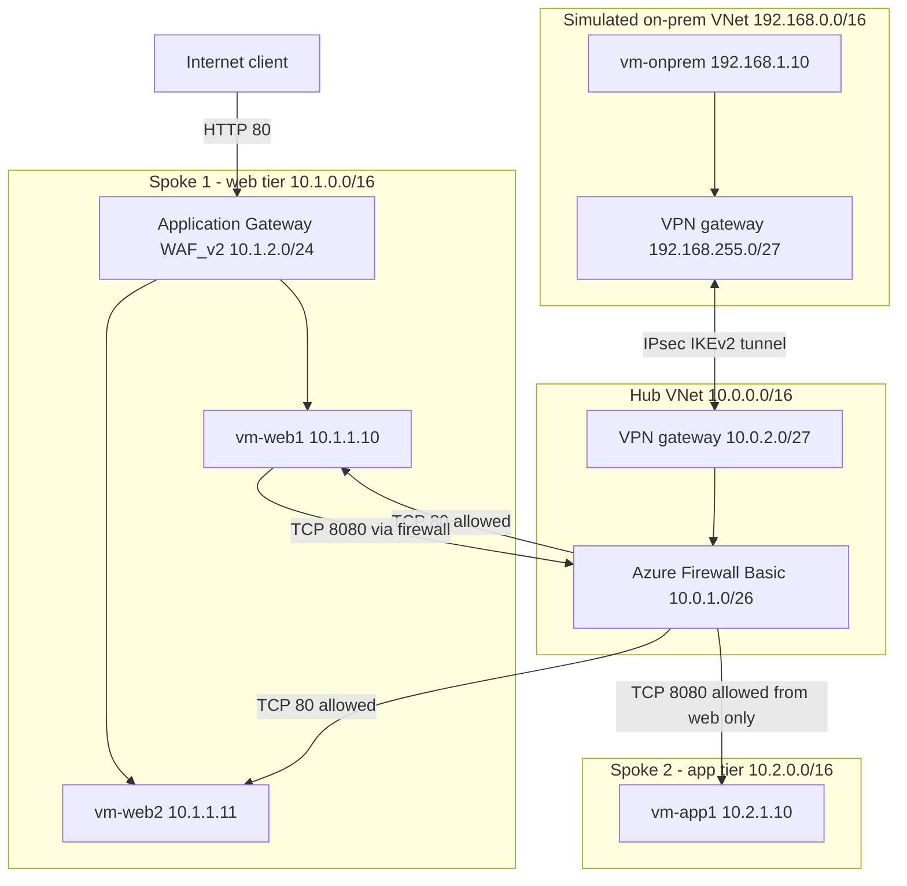
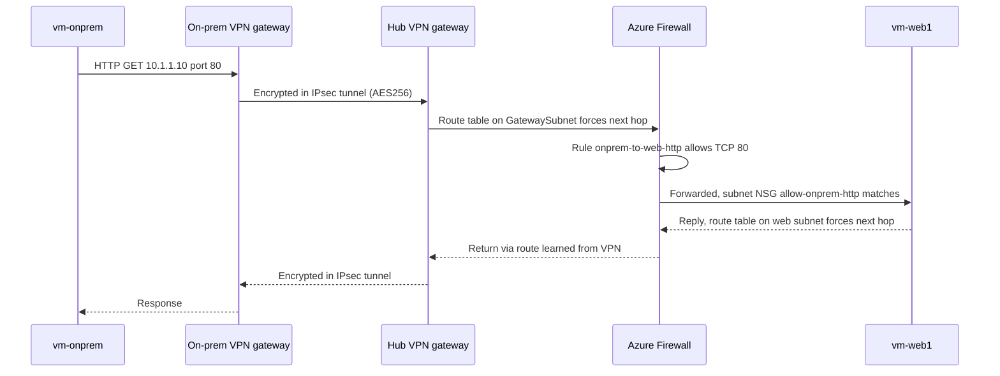
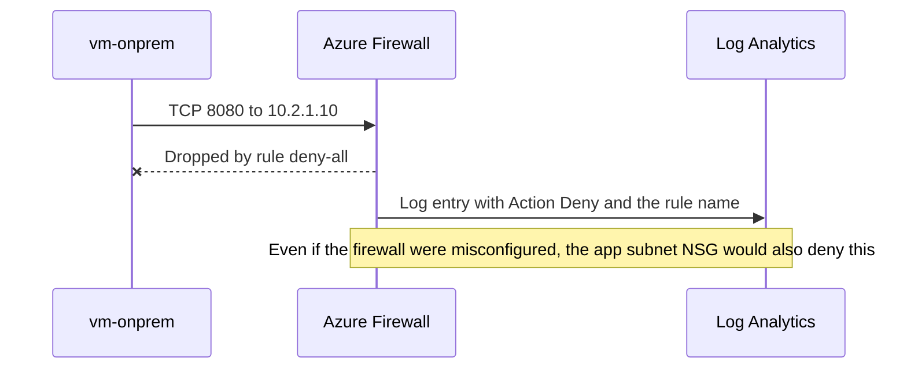
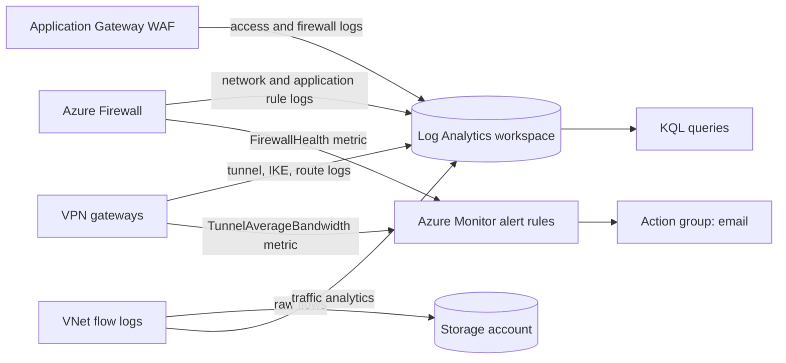

# Hybrid-Network-Lab
# Secure Hybrid Network on Azure

**Site-to-site IPsec VPN, centralized firewall inspection, WAF-protected web tier, and end-to-end network monitoring, built entirely with Terraform.**


WATCH ME WALK THROUGH THIS HERE: https://www.loom.com/share/8e351ce5444f4061ab56fd86aad1e685
---

## Table of Contents

1. [Overview](#overview)
2. [Skills Demonstrated](#skills-demonstrated)
3. [Architecture](#architecture)
4. [Traffic Policy](#traffic-policy)
5. [IP Address Plan (IPAM)](#ip-address-plan-ipam)
6. [Security Design Decisions](#security-design-decisions)
7. [Repository Structure](#repository-structure)
8. [Prerequisites and Cost](#prerequisites-and-cost)
9. [Deploy](#deploy)
10. [Verify It Works](#verify-it-works)
11. [Monitoring and Alerting](#monitoring-and-alerting)
12. [Incident Drill: Break It and Fix It](#incident-drill-break-it-and-fix-it)
13. [Evidence](#evidence)
14. [Troubleshooting](#troubleshooting)
15. [Limitations and Next Steps](#limitations-and-next-steps)
16. [Teardown](#teardown)
17. [Author](#author)

---

## Overview

Most organizations do not live entirely in the cloud. They run workloads in Azure while keeping systems on-premises, and every connection between the two is a place where an attacker could eavesdrop, move laterally, or reach something they should not.

This lab builds that environment and secures it the way a production team would:

- A **hub-and-spoke** network in Azure, with a **simulated on-premises site** connected over an **IPsec VPN**.
- A **central Azure Firewall** that inspects traffic between the on-premises site and every Azure workload, with a default-deny posture.
- A **web tier behind an Application Gateway with a WAF**, load balanced across two servers.
- **Private DNS** that resolves names across all of the networks.
- **Logging, flow logs, and alerts** that make the network observable, plus a deliberate outage drill that shows how to find and fix a failure.

The segmentation pattern is the one used to protect sensitive systems such as patient records: the on-premises site can reach only the web tier, and the app tier accepts traffic only from the web tier. Nothing here is a compliance certification, but the design choices are the same ones auditors and security teams ask about.

Everything is defined as code, so the whole environment can be built, reviewed, rebuilt, and destroyed on demand.

## Skills Demonstrated

| Area | What this lab shows |
|---|---|
| Hybrid connectivity | Site-to-site IPsec/IKEv2 VPN with an explicit crypto policy, local network gateways, gateway transit |
| Network security | Azure Firewall policy with explicit deny, NSG least privilege, WAF in prevention mode |
| Routing | User-defined routes that force traffic through the firewall, traffic symmetry for return paths |
| Load balancing | Layer 7 balancing with health probes (Application Gateway) across two backends |
| DNS and IPAM | Private DNS zone with auto-registration, documented non-overlapping address plan |
| Monitoring | Diagnostic settings, VNet flow logs with traffic analytics, KQL queries, metric alerts |
| Troubleshooting | Network Watcher next hop and IP flow verify, log-driven diagnosis, outage runbook |
| Infrastructure as code | Terraform with `for_each`, `locals`, generated secrets, replace-and-recover workflow |
| Documentation | Architecture diagrams, traffic matrix, runbook, cost and teardown guidance |

---

## Architecture

### Network topology



The hub holds the shared security services (firewall and VPN gateway). Each spoke holds one workload tier. Spokes never talk to each other or to on-premises directly: user-defined routes send every cross-network packet to the firewall first.

### Request path: on-premises to web tier



### Blocked path: on-premises to app tier



### Monitoring and logging flow



---

## Traffic Policy

This table is the contract the lab enforces. Every row is tested in [Verify It Works](#verify-it-works).

| Source | Destination | Port | Result | Enforced by |
|---|---|---|---|---|
| Internet | Web tier via Application Gateway | TCP 80 | Allowed, inspected by WAF | WAF policy (OWASP 3.2, Prevention) |
| Internet | Web tier, malicious request | TCP 80 | Blocked with HTTP 403 | WAF managed rules |
| Internet | Any VM directly | Any | Not reachable | No public IPs on VMs |
| On-premises | Web tier | TCP 80, ICMP | Allowed | Firewall rule `onprem-to-web-http`, NSG `allow-onprem-http` |
| On-premises | App tier | TCP 8080 | **Blocked** | Firewall rule `deny-all`, app NSG `deny-all-inbound` |
| Web tier | App tier | TCP 8080 | Allowed | Firewall rule `web-to-app-8080`, NSG `allow-web-8080` |
| Any internal | Any internal | ICMP | Allowed (diagnostics) | Firewall rule `icmp-internal` |
| Everything else | Everything else | Any | Blocked | Firewall rule `deny-all` |

## IP Address Plan (IPAM)

Every range is defined once in `network.tf` and mirrored here. Ranges never overlap, which keeps future peering and VPN additions safe.

| Network | CIDR | Purpose |
|---|---|---|
| Hub VNet | 10.0.0.0/16 | Shared security services |
| AzureFirewallSubnet | 10.0.1.0/26 | Azure Firewall data path |
| AzureFirewallManagementSubnet | 10.0.1.64/26 | Azure Firewall management (required by Basic SKU) |
| GatewaySubnet (hub) | 10.0.2.0/27 | VPN gateway |
| Spoke 1 VNet | 10.1.0.0/16 | Web tier |
| web-subnet | 10.1.1.0/24 | vm-web1 (10.1.1.10), vm-web2 (10.1.1.11) |
| appgw-subnet | 10.1.2.0/24 | Application Gateway |
| Spoke 2 VNet | 10.2.0.0/16 | App tier |
| app-subnet | 10.2.1.0/24 | vm-app1 (10.2.1.10) |
| On-prem VNet | 192.168.0.0/16 | Simulated on-premises site |
| GatewaySubnet (on-prem) | 192.168.255.0/27 | On-prem VPN gateway |
| onprem-subnet | 192.168.1.0/24 | vm-onprem (192.168.1.10) |

DNS: private zone `lab.internal`, linked to all four VNets. Spoke VMs auto-register (for example `vm-web1-<yourname>.lab.internal`).

---

## Security Design Decisions

The table maps each control to the risk it reduces. Categories are loosely aligned to the NIST Cybersecurity Framework functions.

| Control | Risk it reduces | NIST CSF function | Where |
|---|---|---|---|
| Hub-and-spoke with user-defined routes | Uninspected east-west traffic and lateral movement | Protect | `network.tf`, `security.tf` |
| Firewall policy with explicit deny | Unapproved flows reaching sensitive tiers; gives logs a named rule to search | Protect | `firewall.tf` |
| NSG with explicit final deny | Azure's default rule allows all VirtualNetwork traffic, including peered and on-prem ranges | Protect | `security.tf` |
| Custom IPsec/IKE policy (AES256, SHA256, DH group 14, PFS2048) | Eavesdropping or tampering on the internet path | Protect | `vpn.tf` |
| WAF in Prevention mode | SQL injection, cross-site scripting, and other common web attacks | Protect | `appgw.tf` |
| No public IPs on VMs, access through `az vm run-command` | Exposed SSH or RDP as an attack surface | Protect | `compute.tf` |
| Generated secrets, `.gitignore` for state and tfvars | Credentials committed to source control | Protect | `main.tf`, `.gitignore` |
| Diagnostic settings and VNet flow logs | Blind spots; inability to reconstruct what happened | Detect | `monitoring.tf` |
| Firewall health and tunnel alerts | Slow detection of outages | Detect, Respond | `monitoring.tf` |
| Everything as Terraform, replace-and-recover workflow | Configuration drift, slow recovery | Recover | all files |
| Documented IPAM and topology | Overlapping ranges, undocumented changes | Identify | this README |

---

## Repository Structure

```text
.
├── providers.tf               # Terraform and provider versions
├── variables.tf               # Inputs: subscription, name, region, alert email
├── terraform.tfvars           # Your values (git-ignored, create this yourself)
├── main.tf                    # Resource group, generated secrets, Log Analytics
├── network.tf                 # Address plan, VNets, subnets, peerings
├── security.tf                # Route tables (UDRs) and NSGs
├── firewall.tf                # Azure Firewall, policy, rule collections
├── vpn.tf                     # VPN gateways, local gateways, IPsec connections
├── compute.tf                 # Four B1s VMs with no public IPs
├── cloud-init.yaml.tftpl      # Tiny Python web server for the test VMs
├── appgw.tf                   # Application Gateway, WAF policy
├── dns.tf                     # Private DNS zone and VNet links
├── monitoring.tf              # Flow logs, diagnostics, alerts
├── outputs.tf                 # IPs and names used by the tests
└── .gitignore                 # Keeps state and tfvars out of GitHub
```

## Prerequisites and Cost

**You need:**

- An Azure subscription with the Contributor role (pay-as-you-go recommended; free-tier accounts may lack quota for VPN gateways or Application Gateway)
- [Azure CLI](https://learn.microsoft.com/cli/azure/install-azure-cli), signed in with `az login`
- [Terraform](https://developer.hashicorp.com/terraform/install) 1.5 or later
- A bash terminal (macOS, Linux, Windows Subsystem for Linux, or Azure Cloud Shell)
- An email address for alert notifications

**Cost (estimate, confirm in the Azure pricing calculator):**

| Resource | Approx. hourly |
|---|---|
| Azure Firewall Basic | $0.40 |
| Two VPN gateways | $0.25 to $0.35 each |
| Application Gateway WAF_v2 | $0.45 |
| Four B1s VMs | $0.01 each |
| **Total while running** | **about $1.50 to $2.00** |

A full session takes 4 to 5 hours, including 30 to 45 minutes for the VPN gateways to provision, so plan on roughly **$6 to $10**. These resources bill whether or not traffic flows. [Destroy them](#teardown) when you finish.

---

## Deploy

```bash
git clone https://github.com/michaelmcmurry92/<your-repo-name>.git
cd <your-repo-name>

az login
az account show --query id -o tsv     # copy this value
```

Create `terraform.tfvars` (this file is git-ignored):

```hcl
subscription_id = "00000000-0000-0000-0000-000000000000"   # your subscription ID
yourname        = "michael"                                # lowercase, 14 characters or fewer
location        = "eastus"
alert_email     = "you@example.com"                        # receives alerts
```

Build everything:

```bash
terraform init
terraform plan
terraform apply
```

**What to expect:** the firewall takes 8 to 12 minutes and the VPN gateways take 30 to 45 minutes. They build in parallel, and the spoke peerings finish last because they depend on the hub gateway. This is normal. If apply fails, read the error, fix the cause, and run `terraform apply` again. Terraform resumes where it stopped.

**No secrets to manage:** the VM admin password and the VPN pre-shared key are generated by Terraform's `random` provider. They live only in state, which is git-ignored.

---

## Verify It Works

The VMs have no public IPs, so tests run through `az vm run-command`, which uses the Azure agent instead of an inbound SSH path.

```bash
RG=rg-lab-hybrid-michael
NAME=michael

run() { az vm run-command invoke -g $RG -n "vm-$1-$NAME" --command-id RunShellScript \
        --scripts "$2" --query "value[0].message" -o tsv; }
```

### 1. VPN tunnel is up

```bash
az network vpn-connection show -g $RG -n conn-hub-to-onprem --query connectionStatus -o tsv
az network vpn-connection show -g $RG -n conn-onprem-to-hub --query connectionStatus -o tsv
```

Expected: `Connected` (both).

### 2. Firewall enforces the traffic policy

```bash
run onprem "curl -s -m 5 http://10.1.1.10"                          # on-prem to web
run onprem "curl -s -m 5 http://10.2.1.10:8080 || echo BLOCKED"     # on-prem to app
run web1   "curl -s -m 5 http://10.2.1.10:8080"                     # web to app
run web1   "ping -c 4 10.2.1.10"                                    # check the TTL
```

| Test | Expected |
|---|---|
| On-prem to web | `Hello from vm-web1-michael` |
| On-prem to app | `BLOCKED` (request times out) |
| Web to app | `Hello from vm-app1-michael` |
| Web to app ping | `ttl=63` |

**Why TTL matters:** Linux starts packets at TTL 64 and every routing hop lowers it by 1. TTL 63 proves the packet went through one extra hop, the firewall, so the user-defined routes are doing their job. Peered VMs with no firewall in the path would show 64.

### 3. Application Gateway, load balancing, and WAF

```bash
APPGW=$(terraform output -raw appgw_public_ip)

az network application-gateway show-backend-health -g $RG -n agw-lab-$NAME \
  --query "backendAddressPools[].backendHttpSettingsCollection[].servers[].health" -o tsv

for i in 1 2 3 4 5 6; do curl -s http://$APPGW; done

curl -s -o /dev/null -w "%{http_code}\n" "http://$APPGW/?id=1%27%20OR%20%271%27=%271"
```

Expected: both backends `Healthy`; responses from both `vm-web1` and `vm-web2`; HTTP `403` for the injection attempt.

### 4. Private DNS

```bash
run onprem "getent hosts vm-web1-$NAME.lab.internal"
run web1   "getent hosts vm-app1-$NAME.lab.internal"
```

Expected: `10.1.1.10` and `10.2.1.10`. Auto-registration can take a few minutes.

### 5. Prove the path with Network Watcher

```bash
# Where does web1 send traffic for the app tier? (the firewall)
az network watcher show-next-hop -g $RG --vm vm-web1-$NAME \
  --source-ip 10.1.1.10 --dest-ip 10.2.1.10 --query "{type:nextHopType, ip:nextHopIpAddress}"

# Where does on-prem send traffic for web1? (the VPN gateway)
az network watcher show-next-hop -g $RG --vm vm-onprem-$NAME \
  --source-ip 192.168.1.10 --dest-ip 10.1.1.10 --query "{type:nextHopType}"

# Would the app NSG allow on-prem traffic to port 8080?
az network watcher test-ip-flow -g $RG --vm vm-app1-$NAME --direction Inbound --protocol TCP \
  --local 10.2.1.10:8080 --remote 192.168.1.10:50000 --query "{access:access, rule:ruleName}"
```

Expected: `VirtualAppliance` with the firewall's private IP (compare with `terraform output firewall_private_ip`), `VirtualNetworkGateway`, and `Deny` by `deny-all-inbound`.

On-prem traffic to the app tier is blocked twice, by the firewall and by the NSG. If one control is ever misconfigured, the other still protects the tier.

---

## Monitoring and Alerting

Wait 10 to 15 minutes after running the tests so logs reach Log Analytics, then open **Log Analytics workspace, Logs**.

**Every firewall decision in the last hour**

```kusto
AzureDiagnostics
| where Category == "AzureFirewallNetworkRule"
| where TimeGenerated > ago(1h)
| parse msg_s with Protocol " request from " Source " to " Destination ". Action: " Action "." *
| project TimeGenerated, Protocol, Source, Destination, Action
| order by TimeGenerated desc
```

**Blocked attempts, grouped by source and destination**

```kusto
AzureDiagnostics
| where Category == "AzureFirewallNetworkRule"
| where TimeGenerated > ago(1h)
| parse msg_s with Protocol " request from " Source " to " Destination ". Action: " Action "." *
| where Action == "Deny"
| summarize Attempts = count() by Source, Destination
| order by Attempts desc
```

**VPN tunnel events**

```kusto
AzureDiagnostics
| where Category in ("TunnelDiagnosticLog", "IKEDiagnosticLog")
| where TimeGenerated > ago(2h)
| order by TimeGenerated desc
| take 50
```

**Requests blocked by the WAF**

```kusto
AzureDiagnostics
| where Category == "ApplicationGatewayFirewallLog"
| where action_s == "Blocked"
| project TimeGenerated, clientIp_s, requestUri_s, ruleId_s, Message
| order by TimeGenerated desc
```

**Alerts deployed by Terraform** (Azure Monitor, Alerts, Alert rules), all sending email through one action group:

| Alert | Signal | Notes |
|---|---|---|
| `alert-firewall-health` | `FirewallHealth` below 90 | Severity 1 |
| `alert-vpn-tunnel-idle-or-down` | `TunnelAverageBandwidth` below 1 | Severity 2. Also fires on an idle tunnel, so expect noise in a lab with no traffic |

VNet flow logs are enabled on all four VNets with traffic analytics. Raw flows land in the storage account, and summaries appear in the `NTANetAnalytics` table after up to 30 minutes.

---

## Incident Drill: Break It and Fix It

Detect, diagnose, fix, record. This drill follows that loop with a realistic failure: a pre-shared key mismatch, which is one of the most common causes of a VPN tunnel that will not establish.

**1. Break it.** Change the key on one side and force a renegotiation:

```bash
az network vpn-connection shared-key update -g $RG --connection-name conn-hub-to-onprem --value "WrongKey-12345"
az network vpn-connection reset -g $RG -n conn-hub-to-onprem
```

**2. Detect it.** Allow a few minutes:

```bash
az network vpn-connection show -g $RG -n conn-hub-to-onprem --query connectionStatus -o tsv    # NotConnected
run onprem "curl -s -m 5 http://10.1.1.10 || echo TUNNEL DOWN"
```

**3. Diagnose it.** Run the **VPN tunnel events** query above. A key mismatch appears as repeated IKE authentication failures. This tells you the tunnel is reachable but the two ends cannot agree, which separates it from a routing or firewall problem.

**4. Fix it.** Replace the connection so Terraform restores the known-good key:

```bash
terraform apply -replace='azurerm_virtual_network_gateway_connection.conn["hub-to-onprem"]'
az network vpn-connection show -g $RG -n conn-hub-to-onprem --query connectionStatus -o tsv    # Connected
```

**5. Record it.** Capture symptoms, how you confirmed the cause, the fix, and how you verified recovery.

Infrastructure as code describes the correct state. When a setting is changed by hand, rebuilding from code restores the known-good configuration and leaves a record of what it should be.

---

## Evidence

Add screenshots of your completed deployment to a `docs/images/` folder in this repository, then embed them here. A good set to capture:

- Resource group with every deployed resource
- VPN connection status showing **Connected**
- Firewall policy rules, including the explicit deny
- Effective routes on a VM showing the **Virtual appliance** next hop
- Application Gateway backend health showing **Healthy**
- WAF returning **403** to an injection attempt
- KQL query showing the blocked on-prem to app attempt
- Alert rules in Azure Monitor

<!--
Embed example (uncomment after adding the file):

-->

> Before publishing screenshots, blur or crop subscription IDs, email addresses, and public IPs.

---

## Troubleshooting

| Symptom | Likely cause | What to do |
|---|---|---|
| Apply rejects the VPN gateway SKU | Supported SKUs change by region over time | Check the currently supported VPN gateway SKUs and update `sku` in `vpn.tf` |
| Quota error on gateways or Application Gateway | Free-tier or low default quota | Use a pay-as-you-go subscription or request a quota increase |
| Storage account name error | `yourname` too long or has uppercase characters | Use 14 or fewer lowercase letters and digits |
| Flow log step fails: Network Watcher not found | Network Watcher not enabled in the region | `az network watcher configure -g NetworkWatcherRG -l eastus --enabled true` |
| Spoke peerings take a long time | They wait for the hub VPN gateway | Expected, since gateway transit requires it to exist first |
| Tunnel shows `NotConnected` | Key mismatch, IPsec policy mismatch, or wrong local gateway address | Run the VPN tunnel events query, compare both `ipsec_policy` blocks and the shared key |
| Backend health `Unhealthy` | VMs still running cloud-init, or the NSG blocks the probe | Wait a few minutes; confirm `allow-appgw-http` allows `10.1.2.0/24` |
| Private DNS names do not resolve | Auto-registration delay or missing VNet link | Wait and retry; confirm the links in `dns.tf` |
| `run-command` fails or hangs | VM agent not ready, or the VM is stopped | Confirm the VM is running, wait a minute, retry |
| KQL returns no rows | Ingestion delay | Wait 10 to 15 minutes (up to 30 for traffic analytics); run the table name alone with `take 10` to see columns |

---

## Limitations and Next Steps

A lab is a controlled simulation. These are the gaps between this build and a production environment.

| Limitation | Production approach |
|---|---|
| The "on-premises" site is a second VNet | A real router or firewall appliance over a physical internet or ExpressRoute link |
| Application Gateway listens on HTTP only | HTTPS listener with a certificate from Key Vault, and redirect HTTP to HTTPS |
| Azure Firewall Basic | Standard or Premium for threat intelligence, web categories, and TLS inspection |
| VMs use a generated password | SSH keys or Microsoft Entra login, with Azure Bastion for administration |
| Static VPN routing | BGP for dynamic route exchange and easier multi-site growth |
| On-prem DNS simulated with a VNet link | Azure DNS Private Resolver with conditional forwarders |
| Single region, single tunnel per site | Zone-redundant active-active gateways and a second region |
| No NSG on the Application Gateway subnet | Add one, allowing the required Gateway Manager and health probe traffic |
| Tunnel alert fires when idle | Alert on connection status or BGP state instead of bandwidth |

**Ideas for extending the lab:** add an internal Standard Load Balancer for layer 4 balancing in the app tier, add a Bicep version of the network module, enable HTTPS on the Application Gateway, and add a Private DNS Resolver.

**Lessons learned**

<!-- Replace this with 2 or 3 real issues you hit and how you solved them. This is the section hiring managers read closely. -->

- [Describe one real problem you hit during the build and how you diagnosed it.]
- [Describe one thing you would do differently next time.]

---

## Teardown

Destroy everything as soon as you finish. The firewall, gateways, and Application Gateway bill by the hour.

```bash
terraform destroy
# Deleting the VPN gateways can take 15 to 20 minutes.

az resource list -g rg-lab-hybrid-michael -o table
# Expected: empty, or the resource group no longer exists
```

---

## Author

**Michael McMurry**, Cloud Engineer focused on Azure, Terraform, and network security.

- LinkedIn: [linkedin.com/in/michaelmcmurry](https://www.linkedin.com/in/michaelmcmurry)
- GitHub: [github.com/michaelmcmurry92](https://github.com/michaelmcmurry92)
